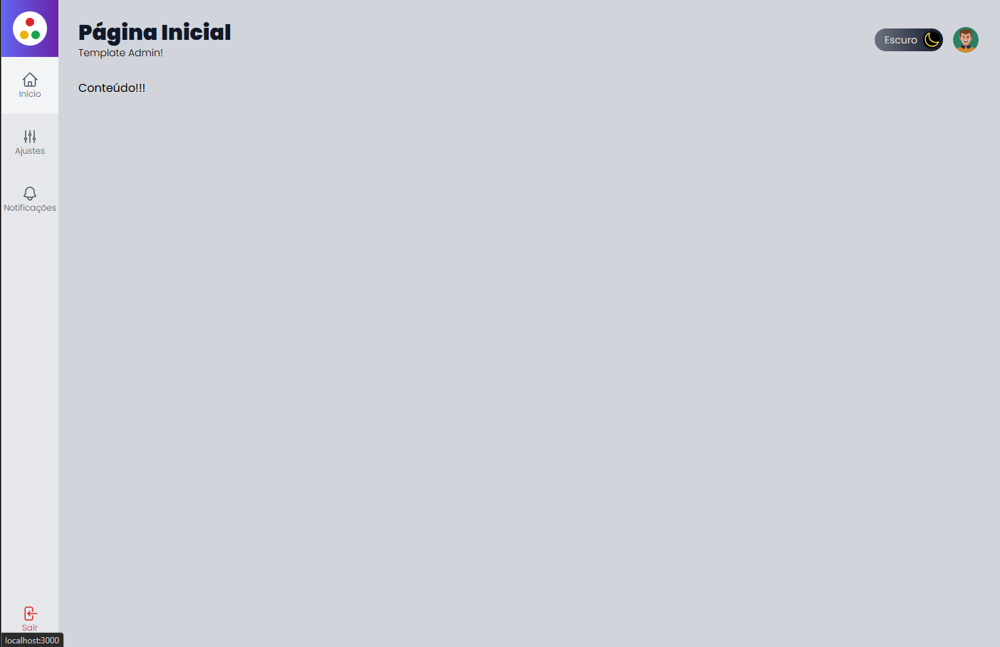
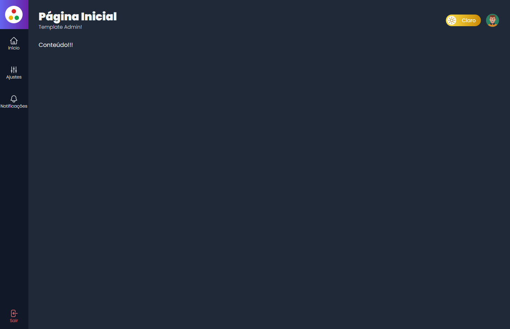

<div align="center">
  <h1>🚀 Next.js Admin Template</h1>
  <p><b>Um template de painel administrativo moderno, responsivo e altamente customizável para aplicações web.</b></p>

  <p>
    
    
    
    
    
  </p>
</div>

<br>

---

## 🎯 Sobre o Projeto

O **Next.js Admin Template** foi desenvolvido como uma base sólida e escalável para diversos tipos de aplicações web que necessitam de um painel de controlo administrativo. O projeto conta com arquitetura limpa, componentes reutilizáveis e foco na experiência do utilizador, integrando tecnologias modernas do ecossistema front-end e backend-as-a-service.

---

## 📸 Demonstração do Projeto

| Tema Claro | Tema Escuro |
| :---: | :---: |
|  |  |

| Tela de Autenticação |
| :---: |
| <div align="center"></div> |

---

## ✨ Principais Recursos

- 🔐 **Autenticação Completa:** Suporte a login tradicional (E-mail e Senha) e autenticação social via **Google** utilizando o Firebase.
- 🌓 **Alternância de Tema (Claro / Escuro):** Sistema de troca de temas integrado que persiste a preferência do utilizador no `localStorage`.
- 📱 **Totalmente Responsivo:** Layout adaptável e otimizado para computadores, tablets e telemóveis.
- 🎛️ **Gestão de Sessão & Cookies:** Proteção de rotas e persistência de sessão integrada com cookies seguros.
- 🎨 **Estilização Moderna:** Design limpo construído com o auxílio do **Tailwind CSS**.

---

## 🛠️ Tecnologias Utilizadas

Este projeto foi construído com a seguinte stack:

* **[Next.js](https://next.js/)** (v14.2.5) - Framework React com renderização híbrida.
* **[React](https://reactjs.org/)** (v18.3.1) - Biblioteca para construção de interfaces.
* **[TypeScript](https://www.typescriptlang.org/)** - Superset JavaScript tipado para maior segurança no código.
* **[Tailwind CSS](https://tailwindcss.com/)** (v3.4.1) - Framework CSS utilitário para estilização rápida.
* **[Firebase](https://firebase.google.com/)** (v8.8.0) - Plataforma de backend para autenticação e serviços em nuvem.
* **Cookies & LocalStorage** - Gestão de preferências e estado de sessão.

---

## ⚙️ Como Executar o Projeto Localmente

Certifica-te de que tens o **Node.js** instalado na tua máquina.

1. **Clona o repositório:**
   ```bash
   git clone https://github.com/Erick-de-Paiva/projeto-template-admin.git
   ```

2. **Acede à pasta do projeto:**
   ```bash
   cd projeto-template-admin
   ```

3. **Instala as dependências:**
   ```bash
   npm install
   ```

4. **Configura as variáveis de ambiente:**
   Cria um ficheiro `.env.local` na raiz do projeto com as tuas credenciais do Firebase:
   ```env
   NEXT_PUBLIC_FIREBASE_API_KEY=sua_api_key
   NEXT_PUBLIC_FIREBASE_AUTH_DOMAIN=seu_auth_domain
   NEXT_PUBLIC_FIREBASE_PROJECT_ID=seu_project_id
   ```

5. **Inicia o servidor de desenvolvimento:**
   ```bash
   npm run dev
   ```

6. Acede a `http://localhost:3000` no teu navegador.
